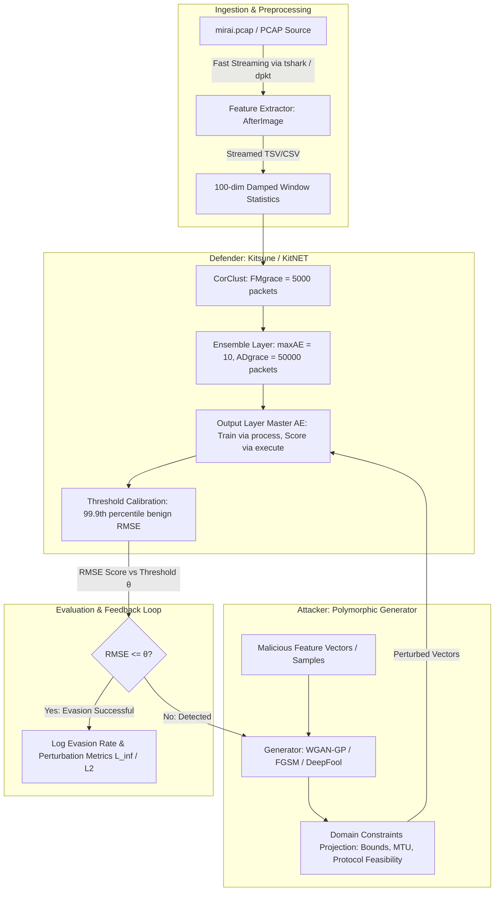

# Implementation Plan: Kitsune NIDS vs. Polymorphic WGAN Pipeline

This plan outlines the architecture, milestone sequence, and technical deliverables for the Kitsune NIDS vs. Polymorphic WGAN pipeline, updated with operational insights from [Note to myself.pdf](file:///home/brooklyng3/projects/grad/Note%20to%20myself.pdf) and strict adherence to [AGENTS.md](file:///home/brooklyng3/projects/grad/AGENTS.md), [.agentignore](file:///home/brooklyng3/projects/grad/.agentignore), and [.gitignore](file:///home/brooklyng3/projects/grad/.gitignore).

---

## 1. Architectural Overview & Workflow

---

## 2. Key Operational Lessons & Pitfalls Integrated

Based on prior experiments ([Note to myself.pdf](file:///home/brooklyng3/projects/grad/Note%20to%20myself.pdf)):
1. **Packet Parser Performance:** Scapy on full multi-hundred-thousand packet traces is excessively slow. Streaming via `tshark` or `dpkt` is essential. If system `tshark` is used, AppArmor permissions must be managed.
2. **Modern NumPy Compatibility:** Ensure legacy `numpy.Inf` is replaced with `numpy.inf` throughout codebase.
3. **Model Persistence Nuance:** Never attempt to pickle the complete `Kitsune` pipeline wrapper (which holds unpicklable parser and open file handles). Persist only the trained neural network (`K.AnomDetector` / `KitNET`).
4. **Inference vs. Training Execution:**
   - Training/Online update uses `process(x)`.
   - Pure inference / evaluation must use `execute(x)` to score without modifying ensemble weights.
5. **Threshold Calibration Standard:**
   - The anomaly alert threshold $\theta$ is calibrated at the **99.9th percentile of benign traffic RMSE** (`threshold = np.percentile(benign_rmses, 99.9)`).
6. **Data & File Discipline:**
   - `mirai.pcap`, `mirai.pcap.tsv`, `mirai_labels.csv`, and `kitsune_mirai_model.pkl` fall under [.agentignore](file:///home/brooklyng3/projects/grad/.agentignore). Always stream iteratively line-by-line using CSV/TSV readers; never read entire files into memory or prompt context.

---

## 3. Phased Milestone Roadmap

### Phase 1: Environment & Project Scaffolding
- **Goal:** Set up directory layout, configuration files, and baseline constraints.
- **Tasks:**
  1. Create directories matching [AGENTS.md](file:///home/brooklyng3/projects/grad/AGENTS.md):
     - `configs/` (`kitsune_config.yaml`, `wgan_config.yaml`)
     - `data/` (`raw/`, `processed/`, `attack_samples/`)
     - `src/` (`defender/`, `attacker/`, `pipeline/`, `utils/`)
     - `tests/`
  2. Define `requirements.txt` (PyTorch, Cython, NumPy, Scikit-learn, Scapy, DPKT, PyYAML, Flake8, Black, Pytest).
  3. Implement `src/utils/constraints.py`:
     - MTU ($\le 1500$), non-negative IATs, TTL in $[1, 255]$.
     - Immutable header preservation and perturbation clamping ($L_\infty \le \epsilon$, $L_2 \le \delta$).
  4. Write initial sanity unit tests in `tests/`.

---

### Phase 2: Feature Pipeline & Defender (Kitsune / KitNET)
- **Goal:** Implement and calibrate the unsupervised online NIDS using PyTorch / modern Python.
- **Tasks:**
  1. **Feature Extraction (`src/defender/afterimage.py`):**
     - Streaming 1D and 2D incremental damped window statistics (100 feature dimensions).
     - Streaming reader supporting pre-extracted TSV/CSV (`mirai.pcap.tsv`) and live packet streaming (`dpkt` / `tshark`).
  2. **KitNET Architecture (`src/defender/kitnet.py`):**
     - **CorClust:** Correlation clustering over initial `FMgrace = 5000` packets to group features for micro-autoencoders (`maxAE = 10`).
     - **Ensemble Layer:** Parallel autoencoders trained online over `ADgrace = 50000` packets.
     - **Output Layer:** Master autoencoder scoring final RMSE.
     - **API Separation:** Explicit `train_step(x)` (or `process(x)`) vs pure `predict(x)` (or `execute(x)`) without weight mutation.
     - **Persistence:** Standalone serialization/deserialization for KitNET model weights (`kitsune_mirai_model.pkl`), independent of packet parsers.
  3. **Threshold Calibration (`src/defender/eval_threshold.py`):**
     - Stream `mirai.pcap.tsv` and `mirai_labels.csv`.
     - Calibrate $\theta$ at benign 99.9th percentile:
       $$\theta = \text{percentile}(\text{benign\_rmses}, 99.9)$$
     - Compute baseline detection rate ($\text{RMSE} > \theta$) and evasion rate ($\text{RMSE} \le \theta$).
  4. **Unit Tests:**
     - `tests/test_kitnet.py` verifying weight isolation during inference, forward pass shapes, and persistence.

---

### Phase 3: Attacker Engine (WGAN-GP & Gradient Baselines)
- **Goal:** Build the polymorphic mutation generator to perturb attack traffic while preserving feasibility.
- **Tasks:**
  1. **Perturbation Baselines (`src/attacker/perturbations.py`):**
     - Fast Gradient Sign Method (FGSM) adapted for autoencoder reconstruction loss under $L_\infty$ bound.
     - DeepFool iterative perturbation tailored for continuous network feature vectors.
  2. **WGAN-GP Architecture (`src/attacker/generator.py`, `src/attacker/discriminator.py`):**
     - **Generator:** MLP conditioning on noise $z$ and malicious feature vector $x_{\text{mal}}$, generating perturbed candidate $x_{\text{adv}}$.
     - **Critic (Discriminator):** Evaluates realism of perturbed traffic against benign feature distribution.
     - **Gradient Penalty:** Enforces 1-Lipschitz continuity ($\lambda_{GP} = 10$).
     - Differentiable projection onto feasible feature bounds defined in `src/utils/constraints.py`.
  3. **Unit Tests:**
     - `tests/test_attacker.py` validating generator bounds, critic loss, and perturbation constraints.

---

### Phase 4: Automated Evaluation & Feedback Loop
- **Goal:** Connect defender and attacker into an automated closed-loop evaluation system.
- **Tasks:**
  1. **Evaluation Engine (`src/pipeline/evaluator.py`):**
     - Stream clean benign vs. raw attack vs. mutated attack data through Kitsune in pure inference mode (`execute(x)` with `torch.no_grad()`).
     - Track Detection Rate, False Positive Rate (FPR), and Evasion Rate (ASR).
  2. **Feedback Loop (`src/pipeline/feedback_loop.py`):**
     - Iterative loop: Malicious samples $\rightarrow$ Attacker mutates $\rightarrow$ Kitsune scores RMSE $\rightarrow$ feedback updates mutation until $\text{RMSE} \le \theta$ or perturbation budget is exhausted.
  3. **Memory & Resource Discipline:**
     - GPU VRAM constrained $< 4$ GB; batch sizes 64–256.
     - Periodic `torch.cuda.empty_cache()` between evaluation cycles.

---

### Phase 5: Metrics, Reporting & CLI
- **Goal:** Benchmark robustness and output detailed evasion analysis.
- **Tasks:**
  1. **Metrics Engine (`src/utils/metrics.py`):**
     - Adversarial Success Rate (ASR) curve vs. $\epsilon$ ($L_\infty$) and $\delta$ ($L_2$).
     - Feature distortion distances ($L_0, L_1, L_2, L_\infty$).
     - Inference and mutation throughput (samples/sec).
  2. **Pipeline Runner (`run_pipeline.py`):**
     - Unified CLI allowing configuration via `configs/kitsune_config.yaml` and `configs/wgan_config.yaml`.
     - Output JSON summaries and evaluation plots.
