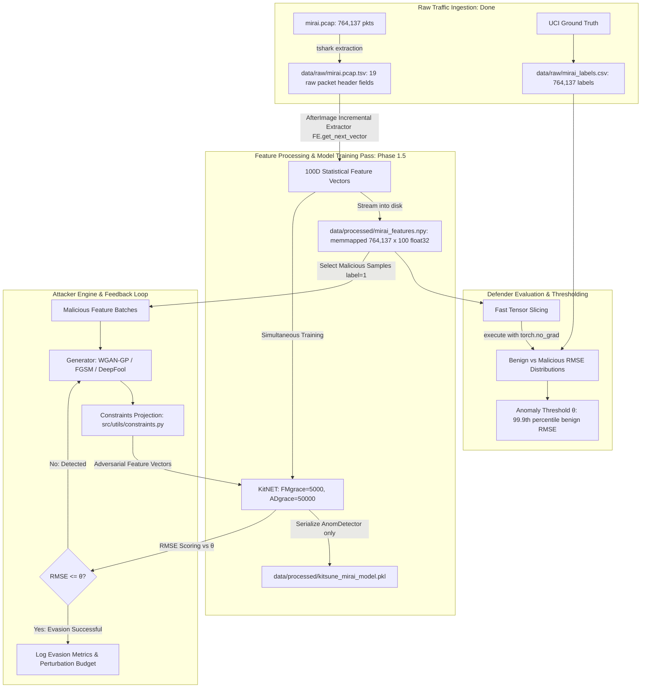

# Implementation Plan: Kitsune NIDS vs. Polymorphic WGAN Pipeline

This plan outlines the architecture, milestone sequence, and technical deliverables for the Kitsune NIDS vs. Polymorphic WGAN pipeline, updated to address the distinction between raw packet dissections and statistical feature matrices, and strictly adhering to [AGENTS.md](file:///home/brooklyng3/projects/grad/AGENTS.md), [.agentignore](file:///home/brooklyng3/projects/grad/.agentignore), and [.gitignore](file:///home/brooklyng3/projects/grad/.gitignore).

---

## 1. Architectural Overview & Workflow

---

## 2. Key Architectural Invariants & Pitfalls Addressed

1. **Raw Dissection TSV vs. 100D Feature Vector (Fact Checker Concern #2):**
   - `data/raw/mirai.pcap.tsv` contains raw Wireshark text fields (`eth.src`, `ip.src`, MAC addresses, hex/strings). Attempting `np.array(tsv_row, dtype=float)` on this file causes a `ValueError: could not convert string to float`.
   - The 100 continuous numeric features are output by **AfterImage** (`FE.get_next_vector()`).
   - In Phase 1.5, we will stream `data/raw/mirai.pcap.tsv` through `AfterImage` once, saving the resulting 100D numeric vectors into memory-mapped `data/processed/mirai_features.npy` (~305 MB as float32).
   - This allows threshold evaluation, baseline testing, and WGAN-GP mutation batches to load tensors in milliseconds without re-running AfterImage packet-by-packet.
2. **Model Persistence Isolation (Fact Checker Concern #3):**
   - Never serialize the outer `Kitsune` instance `K` (which contains file descriptors and `FeatureExtractor` parser states).
   - Only serialize `K.AnomDetector` (the `KitNET` ensemble network) into `data/processed/kitsune_mirai_model.pkl`.
3. **Execution Separation:**
   - Training: `kitnet.process(x)` updates feature mapping and autoencoder weights during grace periods.
   - Inference/Evaluation: `kitnet.execute(x)` scores reconstruction RMSE in pure forward mode without mutating weights.
4. **Calibrated Threshold:**
   - Threshold $\theta$ is set at the 99.9th percentile of benign traffic RMSE:
     $$\theta = \text{percentile}(\text{benign\_rmses}, 99.9)$$

---

## 3. Phased Milestone Roadmap

### Phase 0: Legacy Migration & System Tools (Completed)
- Ported `Kitsune-py` to Python 3.12 (replaced deprecated `np.Inf` / `numpy.Inf`).
- Compiled native Cython extension `AfterImage_extrapolate`.
- Installed system `tshark` and verified integration with `FeatureExtractor.py`.
- Documented in [docs/detailed/phase_0_detailed.md](file:///home/brooklyng3/projects/grad/docs/detailed/phase_0_detailed.md).

### Phase 0.5: Data Ingestion & Ground Truth Setup (Completed)
- Unpacked `data/raw/mirai.pcap` (764,137 packets).
- Downloaded `data/raw/mirai_labels.csv` (764,137 matching binary labels).
- Dissected packets into `data/raw/mirai.pcap.tsv` (19 raw fields) via `tshark`.
- Documented in [docs/detailed/phase_0_5_detailed.md](file:///home/brooklyng3/projects/grad/docs/detailed/phase_0_5_detailed.md).

---

### Phase 1: Project Scaffolding & Domain Constraints (Completed)
- **Goal:** Set up modular project structure, configuration files, and domain invariant constraints.
- **Tasks:**
  1. Build repository directory structure matching [AGENTS.md](file:///home/brooklyng3/projects/grad/AGENTS.md):
     - `configs/` (`kitsune_config.yaml`, `wgan_config.yaml`)
     - `src/` (`defender/`, `attacker/`, `pipeline/`, `utils/`)
     - `tests/`
  2. Implement `src/utils/constraints.py`:
     - MTU ($\le 1500$), non-negative IATs, TTL in $[1, 255]$.
     - Feature range clipping and perturbation bounds ($L_\infty \le \epsilon$, $L_2 \le \delta$).
  3. Implement `tests/test_constraints.py` and run `pytest`.

---

### Phase 1.5: Feature Extraction & KitNET Training Run (Completed)
- **Goal:** Stream `data/raw/mirai.pcap.tsv` through AfterImage, train KitNET, and persist both `mirai_features.npy` and `kitsune_mirai_model.pkl`.
- **Tasks:**
  1. Write streaming extractor script `scripts/extract_and_train.py`:
     - Streams `data/raw/mirai.pcap.tsv` line-by-line via `FE.get_next_vector()`.
     - Writes extracted 100D float vectors directly into memory-mapped array `data/processed/mirai_features.npy` (shape: `[764137, 100]`, `float32`).
     - Simultaneously trains `KitNET(100, maxAE=10, FMgrace=5000, ADgrace=50000)`.
     - Saves only `K.AnomDetector` to `data/processed/kitsune_mirai_model.pkl`.
  2. *Resource Notice:* Pause and notify user before running this feature extraction pass.

---

### Phase 2: Defender Evaluation & Threshold Calibration (Completed)
- **Goal:** Calibrate alert threshold $\theta$ using memory-mapped features and ground truth labels.
- **Tasks:**
  1. Implement `src/defender/eval_threshold.py`:
     - Fast vector evaluation using `mirai_features.npy` and `mirai_labels.csv`.
     - Score benign packets in `execute` mode; set $\theta = \text{percentile}(\text{benign\_rmses}, 99.9)$.
     - Measure baseline Detection Rate and Evasion Rate on raw attack packets.
  2. Implement `tests/test_kitnet.py`.

---

### Phase 3: Attacker Engine (WGAN-GP & Gradient Perturbations) (Completed)
- **Goal:** Implement polymorphic mutation generator for feature vectors under domain constraints.
- **Tasks:**
  1. Implement `src/attacker/perturbations.py`:
     - FGSM baseline adapted for autoencoder reconstruction loss.
     - DeepFool baseline.
  2. Implement `src/attacker/generator.py` and `src/attacker/discriminator.py`:
     - WGAN-GP generator conditioning on malicious feature vectors.
     - Critic evaluating realism vs benign distribution with Gradient Penalty ($\lambda_{GP}=10$).
     - Differentiable projection layers enforcing domain constraints.
  3. Implement `tests/test_attacker.py`.

---

### Phase 4: Automated Evaluation & Feedback Loop (Completed; remediated in Phase 6)
- **Goal:** Closed-loop iteration mutating traffic until $\text{RMSE} \le \theta$.
- **Tasks Completed:**
  1. Implemented `src/pipeline/evaluator.py`: Decoupled $\text{ASR}_{\text{cond}}$ vs $\text{ER}_{\text{total}}$, norm distance tracking ($L_0, L_1, L_2, L_\infty$).
  2. Implemented `src/pipeline/feedback_loop.py`: Composite hinge evasion loss backpropagating through Kitsune autoencoders.
  3. Implemented `tests/test_pipeline.py`.
  4. Documented in `docs/overview/phase_4_overview.md` and `docs/detailed/phase_4_detailed.md`.
- **Phase 6 corrections:** disjoint stratified training split, shared train/eval epsilon persisted in checkpoint metadata, `n_critic` execution, holdout model selection, and a best-of-k retry attack.

---

### Phase 5: Metrics, Reporting & End-to-End CLI Pipeline (Completed)
- **Goal:** Metrics logging, reporting suite, and unified CLI runner.
- **Tasks Completed:**
  1. Implemented `src/utils/metrics.py`: Detection metrics (ROC-AUC, Precision, Recall/TPR, FPR, F1, Accuracy), distortion trade-off curves, markdown tables, JSON/CSV exporters.
  2. Implemented root CLI runner `run_pipeline.py`: Supports 5 execution modes (`evaluate_clean`, `fgsm_sweep`, `pgd_attack`, `train_wgan`, `evaluate_all`).
  3. Implemented `tests/test_metrics.py` (all 22 project tests passing).
  4. Generated comprehensive benchmark reports in `reports/`.
  5. Documented in `docs/overview/phase_5_overview.md` and `docs/detailed/phase_5_detailed.md`.

---

### Phase 6: Review Remediation & Honest Attribution (Completed)
- **Goal:** Address every finding in the independent review
  (`docs/review_findings.md`) without weakening the benchmark.
- **Tasks Completed:**
  1. Removed the post-hoc manifold clamp so the generator learns the target
     step, and added clamp-only/untrained controls plus a benign-kNN realism
     metric. The trained generator now beats the clamp while the untrained one
     scores 0%.
  2. Unified the training/evaluation epsilon (`--eps`), persisted it in
     checkpoint metadata, and set the config default to 2.0.
  3. Added disjoint modulo splits for attack train/eval and parity splits for
     benign calibration/validation.
  4. Executed `n_critic`, added held-out epoch scoring and best-checkpoint
     selection, and made training data cover both scanning and flood.
  5. Added seeded best-of-k and feedback-refinement attacks plus an
     out-of-sample FPR measurement.
  6. Enforced MTU/IAT bounds; documented the TTL limitation.
  7. Wired the Cython extractor as an opt-in, benchmarked DeepFool, regenerated
     all reports, added a README, and repaired documentation links.
  8. Documented in `docs/overview/phase_6_overview.md` and
     `docs/detailed/phase_6_detailed.md`.
